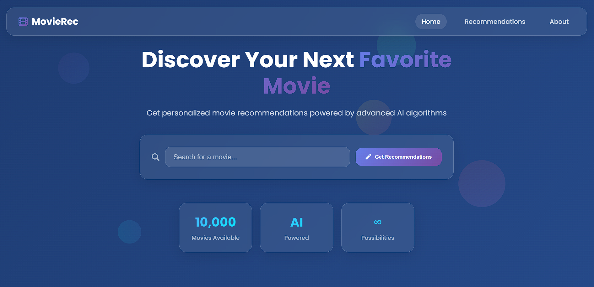
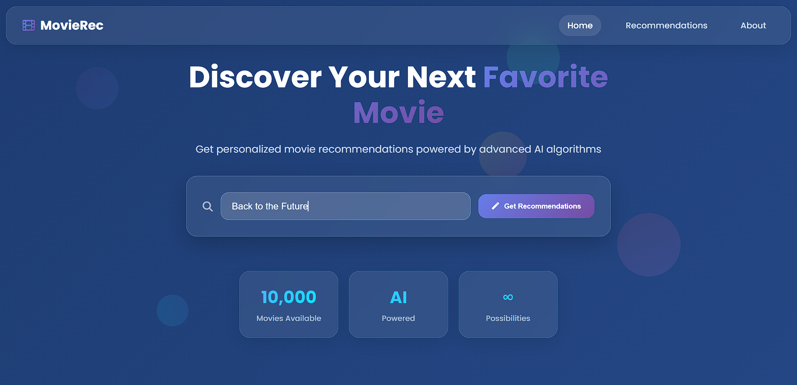
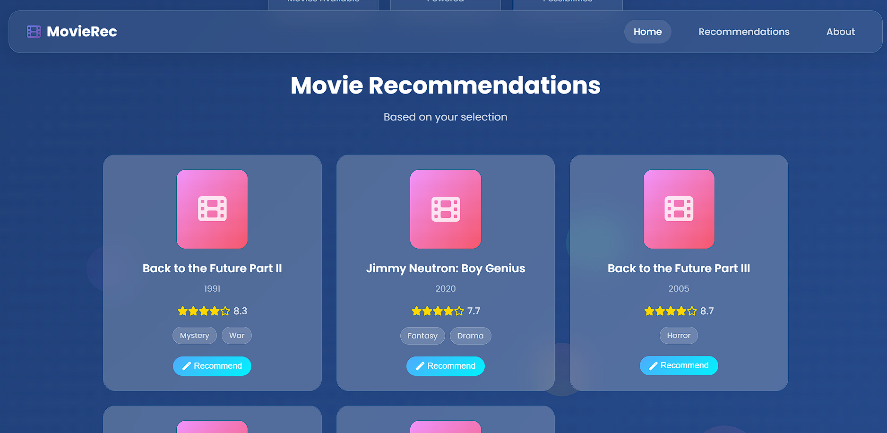
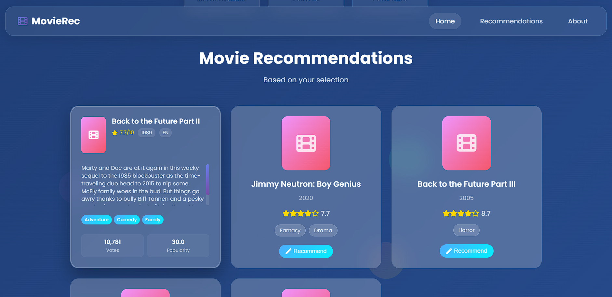

<div align="center">

# 🎬 MovieRec - AI-Powered Movie Recommendation System

*Discover your next favorite movie with advanced AI algorithms and beautiful glassmorphism design*

[](https://python.org)
[](https://fastapi.tiangolo.com)
[](https://github.com/astral-sh/uv)
[](LICENSE)

</div>

---

## ✨ **Features**

🎯 **Smart Recommendations** - AI-powered content-based filtering using cosine similarity  
🎨 **Glassmorphism UI** - Modern, beautiful interface with smooth animations  
⚡ **FastAPI Backend** - High-performance REST API with memory optimization  
🔍 **Real-time Search** - Instant movie suggestions with autocomplete  
📊 **Rich Movie Details** - Comprehensive information with ratings, genres, and plots  
🃏 **Interactive Cards** - Smooth flip animations revealing detailed movie information  
📱 **Responsive Design** - Perfect experience across all devices  

---

## 🖼️ **Application Preview**

<div align="center">

### 🏠 **Home Page - Beautiful Glassmorphism Design**
*Modern interface with search functionality and animated statistics*



### 🔍 **Smart Search with Real-time Suggestions**
*Intelligent autocomplete with instant movie suggestions*



### 🎬 **AI-Powered Movie Recommendations**
*Discover similar movies with detailed information cards*



### 🃏 **Interactive Card Animations** 
*Smooth 3D flip effects revealing comprehensive movie details*




</div>

---

## 🚀 **Quick Start**

### **Prerequisites**
- Python 3.8+
- [UV Package Manager](https://github.com/astral-sh/uv) (recommended)

### **1. Clone the Repository**
```bash
git clone https://github.com/darshan-dalvi/Movie-Recommendation-System.git
cd Movie-Recommendation-System
```

### **2. Install Dependencies**
```bash
# Install UV (if not already installed)
pip install uv

# Install project dependencies
uv sync
```

### **3. Generate Required Model Files**
> ⚠️ **Important**: You must generate the pickle files before running the application!

```bash
# Open and run the Jupyter notebook to generate model files
jupyter notebook notebooks/recommendation_engine.ipynb
```

**What this does:**
- Processes the `Movies_data.csv` dataset
- Generates `models/movies_list.pkl` (movie data)
- Creates `models/similarity.pkl` (similarity matrix)

### **4. Run the Application**

**Start the FastAPI Backend:**
```bash
uv run python main.py
```
*Backend will be available at: http://localhost:8000*

**Start the Frontend (in a new terminal):**
```bash
cd frontend
uv run python -m http.server 3000
```
*Frontend will be available at: http://localhost:3000*

---

## 📁 **Project Structure**

```
Movie-Recommendation-System/
├── 📊 Movies_data.csv              # Dataset (10,000+ movies)
├── 📔 notebooks/
│   └── recommendation_engine.ipynb # Data processing & model generation
├── 🗂️ models/
│   ├── movies_list.pkl            # Processed movie data
│   └── similarity.pkl             # Cosine similarity matrix
├── 🌐 frontend/
│   ├── index.html                 # Main HTML file
│   ├── css/styles.css            # Glassmorphism styling
│   └── js/script.js              # Interactive functionality
├── ⚡ app.py                      # FastAPI backend
├── 🚀 main.py                     # Application entry point
├── 📦 pyproject.toml              # UV dependencies
└── 📖 README.md                   # This file
```

---

## 🎯 **How It Works**

### **1. Data Processing**
- Loads movie dataset with 10,000+ films
- Processes features: genres, overview, cast, crew
- Creates TF-IDF vectorization for content similarity

### **2. Recommendation Engine**
- Uses **cosine similarity** for content-based filtering
- Memory-optimized lazy loading for large similarity matrices
- Returns top 5 most similar movies

### **3. Modern Web Interface**
- **FastAPI** REST API with comprehensive endpoints
- **Glassmorphism** design with backdrop blur effects
- **Real-time search** with debounced autocomplete
- **3D flip animations** for movie card interactions

---

## 🛠️ **API Endpoints**

| Method | Endpoint | Description |
|--------|----------|-------------|
| `GET` | `/` | API information and available endpoints |
| `GET` | `/movies` | Get all available movies (10,000+) |
| `POST` | `/recommend` | Get movie recommendations |
| `GET` | `/movie/{title}` | Get detailed movie information |
| `GET` | `/health` | Health check and system status |

### **Example API Usage**

```bash
# Get movie recommendations
curl -X POST "http://localhost:8000/recommend" \
     -H "Content-Type: application/json" \
     -d '{"movie_title": "The Shawshank Redemption"}'

# Get movie details
curl "http://localhost:8000/movie/The%20Shawshank%20Redemption"
```

---

## 🎨 **Technology Stack**

### **Backend**
- **FastAPI** - Modern, fast web framework
- **Pandas** - Data manipulation and analysis
- **Scikit-learn** - Machine learning algorithms
- **Uvicorn** - ASGI server implementation

### **Frontend**
- **Vanilla JavaScript** - Interactive functionality
- **CSS3** - Glassmorphism design with backdrop-filter
- **HTML5** - Semantic markup structure

### **Data Science**
- **TF-IDF Vectorization** - Text feature extraction
- **Cosine Similarity** - Content-based recommendation
- **Pandas** - Data processing and analysis

---

## 🔧 **Configuration**

### **Environment Variables**
```bash
# Optional: TMDB API key for movie posters
TMDB_API_KEY=your_api_key_here
```

### **Performance Tuning**
- Adjust similarity matrix loading in `app.py`
- Configure memory limits for large datasets
- Optimize chunk sizes for better performance

---

## 📈 **Performance Features**

- ⚡ **Memory Optimization** - Lazy loading of large similarity matrices
- 🚀 **Fast API Response** - Optimized endpoints with async/await
- 💾 **Efficient Caching** - Model files cached after first load
- 📱 **Responsive Design** - Optimized for all screen sizes

---

## 🤝 **Contributing**

We welcome contributions! Here's how you can help:

1. **Fork** the repository
2. **Create** a feature branch (`git checkout -b feature/amazing-feature`)
3. **Commit** your changes (`git commit -m 'Add amazing feature'`)
4. **Push** to the branch (`git push origin feature/amazing-feature`)
5. **Open** a Pull Request

### **Development Setup**
```bash
# Install development dependencies
uv sync --group dev

# Run tests
uv run pytest

# Format code
uv run black .
uv run isort .
```

---

## 🎯 **Future Enhancements**

- [ ] **Hybrid Recommendations** - Combine content-based and collaborative filtering
- [ ] **User Profiles** - Personalized recommendations based on viewing history
- [ ] **Real Movie Posters** - Integration with TMDB API for movie images
- [ ] **Advanced Filters** - Filter by genre, year, rating, language
- [ ] **Social Features** - Share recommendations and create watchlists
- [ ] **Mobile App** - React Native or Flutter mobile application

---

## 📜 **License**

This project is licensed under the **MIT License** - see the [LICENSE](LICENSE) file for details.

---

## 🙏 **Acknowledgments**

- **Dataset**: Movie data sourced from various public APIs
- **Design Inspiration**: Modern glassmorphism UI trends
- **Technology**: Built with love using FastAPI and modern web technologies

---

<div align="center">

### 🎬 **Ready to discover your next favorite movie?**

**[🚀 Get Started](#-quick-start) | [📖 Documentation](#-api-endpoints) | [🤝 Contribute](#-contributing)**

*Made with ❤️ by [Darshan Dalvi](https://github.com/darshan-dalvi)*

---

**⭐ Star this repo if you found it helpful!**

</div>
